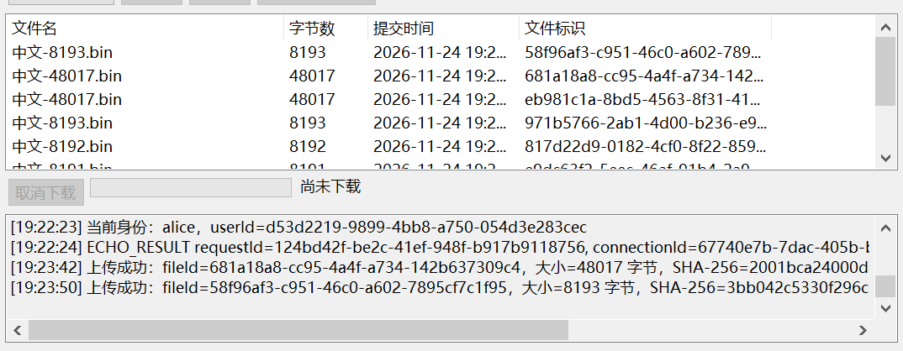
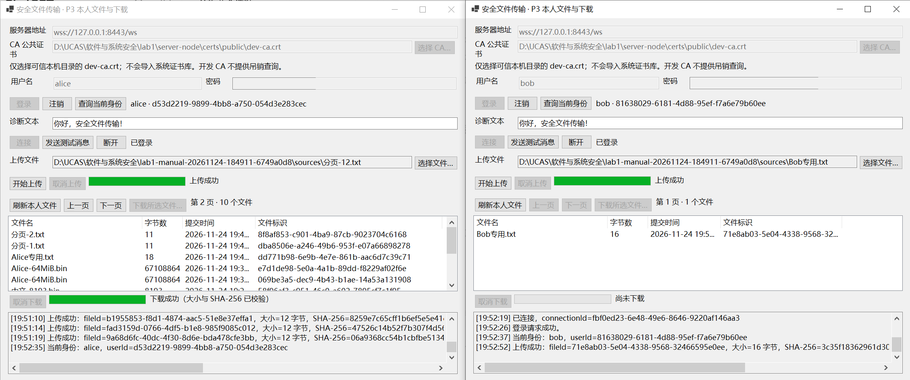

运行环境：
便携 Node：
health stage：
构建结果：
显示缩放：

A01：ok
A02：ok
A03：ok
A04：ok

B01：ok
B02：0 / 1 / 8191 / 8192 / 8193 / 48017 字节分别的结果 ok
[19:17:07] 已连接，connectionId=67740e7b-7dac-405b-b038-4091737e83ed
[19:17:08] 登录请求成功。
[19:17:25] 当前身份：alice，userId=d53d2219-9899-4bb8-a750-054d3e283cec
[19:20:48] 上传成功：fileId=8b7432c2-59ff-4a43-bc34-6c77b0ec09c2，大小=0 字节，SHA-256=e3b0c44298fc1c149afbf4c8996fb92427ae41e4649b934ca495991b7852b855
[19:21:11] 上传成功：fileId=f4254233-fa6b-4a02-9a58-d13f83b9580c，大小=1 字节，SHA-256=4b68ab3847feda7d6c62c1fbcbeebfa35eab7351ed5e78f4ddadea5df64b8015
[19:21:21] 上传成功：fileId=e9dc63f2-5eec-46af-91b4-2a98df8f5204，大小=8191 字节，SHA-256=8073a2b2eacda74b669f3a316328731b478476f66f8d3b4ab047983ec63c6d95
[19:21:27] 上传成功：fileId=817d22d9-0182-4cf0-8f22-859163aea974，大小=8192 字节，SHA-256=21df62f0e8d367180b8b5c9784d169ccea9111517fae2b801e0bbfb3caa50735
[19:21:39] 上传成功：fileId=971b5766-2ab1-4d00-b236-e90d9d4995d0，大小=8193 字节，SHA-256=3bb042c5330f296c3b119707fe8812280f4f50d2d50a5b7f2f4250cbb72acdfb
[19:21:49] 上传成功：fileId=eb981c1a-8bd5-4563-8f31-41c8a32c79ce，大小=48017 字节，SHA-256=2001bca24000d868d6417dbd3c23116c25f3d7505c03f6f2f7a74340418225e4
[19:22:20] ECHO_RESULT requestId=77c649ef-56c6-49f7-b9ea-e04e16fdc961, connectionId=67740e7b-7dac-405b-b038-4091737e83ed
[19:22:23] 当前身份：alice，userId=d53d2219-9899-4bb8-a750-054d3e283cec
[19:22:24] ECHO_RESULT requestId=124bd42f-be2c-41ef-948f-b917b9118756, connectionId=67740e7b-7dac-405b-b038-4091737e83ed

B03：两个文件 ID 是否不同、两份下载是否一致 ok
[19:23:50] 上传成功：fileId=58f96af3-c951-46c0-a602-7895cf7c1f95，大小=8193 字节，SHA-256=3bb042c5330f296c3b119707fe8812280f4f50d2d50a5b7f2f4250cbb72acdfb

[19:33:53] 下载成功：D:\UCAS\软件与系统安全\lab1-manual-20261124-184911-6749a0d8\downloads-alice\中文-8193-首次.bin；fileId=971b5766-2ab1-4d00-b236-e90d9d4995d0；8193 字节；SHA-256=3bb042c5330f296c3b119707fe8812280f4f50d2d50a5b7f2f4250cbb72acdfb
[19:34:07] 下载成功：D:\UCAS\软件与系统安全\lab1-manual-20261124-184911-6749a0d8\downloads-alice\中文-8193-重复.bin；fileId=58f96af3-c951-46c0-a602-7895cf7c1f95；8193 字节；SHA-256=3bb042c5330f296c3b119707fe8812280f4f50d2d50a5b7f2f4250cbb72acdfb
B04：ok
[19:34:53] 上传成功：fileId=069be3a5-dec9-4b43-b1ae-14a53a131908，大小=67108864 字节，SHA-256=301d1a3da0c93bd158cee18739f3d3f7fd0929f34009b8f080ce1e39a5536f8b
B05：ok
[19:34:53] 上传成功：fileId=069be3a5-dec9-4b43-b1ae-14a53a131908，大小=67108864 字节，SHA-256=301d1a3da0c93bd158cee18739f3d3f7fd0929f34009b8f080ce1e39a5536f8b
[19:35:35] ECHO_RESULT requestId=6266c44d-c7ba-4f84-bf51-ddafc6dcbfca, connectionId=67740e7b-7dac-405b-b038-4091737e83ed
[19:35:42] 上传已取消，未自动重传。
[19:36:01] 当前身份：alice，userId=d53d2219-9899-4bb8-a750-054d3e283cec
[19:36:04] ECHO_RESULT requestId=30fa5b0d-3d0b-45ba-86ff-9d4800fd47b7, connectionId=67740e7b-7dac-405b-b038-4091737e83ed
[19:38:52] ECHO_RESULT requestId=cffa4a6d-dd0e-4604-9d14-8b0de3099a68, connectionId=67740e7b-7dac-405b-b038-4091737e83ed
[19:39:05] 上传成功：fileId=e7d1de98-5e0a-4a1b-89dd-f8229af02f6e，大小=67108864 字节，SHA-256=301d1a3da0c93bd158cee18739f3d3f7fd0929f34009b8f080ce1e39a5536f8b
[19:39:09] ECHO_RESULT requestId=5241c126-5764-4162-8f5f-544faa9c6732, connectionId=67740e7b-7dac-405b-b038-4091737e83ed

C01：ok
C02：本轮 12 个分页对象是否齐全 ok
C03：ok

D01：ok
[19:52:35] 当前身份：alice，userId=d53d2219-9899-4bb8-a750-054d3e283cec
[19:55:03] 下载成功：D:\UCAS\软件与系统安全\lab1-manual-20261124-184911-6749a0d8\downloads-alice\中文-0.bin；fileId=8b7432c2-59ff-4a43-bc34-6c77b0ec09c2；0 字节；SHA-256=e3b0c44298fc1c149afbf4c8996fb92427ae41e4649b934ca495991b7852b855
[19:55:07] 下载成功：D:\UCAS\软件与系统安全\lab1-manual-20261124-184911-6749a0d8\downloads-alice\中文-1.bin；fileId=f4254233-fa6b-4a02-9a58-d13f83b9580c；1 字节；SHA-256=4b68ab3847feda7d6c62c1fbcbeebfa35eab7351ed5e78f4ddadea5df64b8015
[19:55:12] 下载成功：D:\UCAS\软件与系统安全\lab1-manual-20261124-184911-6749a0d8\downloads-alice\中文-8191.bin；fileId=e9dc63f2-5eec-46af-91b4-2a98df8f5204；8191 字节；SHA-256=8073a2b2eacda74b669f3a316328731b478476f66f8d3b4ab047983ec63c6d95
[19:55:19] 下载成功：D:\UCAS\软件与系统安全\lab1-manual-20261124-184911-6749a0d8\downloads-alice\中文-8192.bin；fileId=817d22d9-0182-4cf0-8f22-859163aea974；8192 字节；SHA-256=21df62f0e8d367180b8b5c9784d169ccea9111517fae2b801e0bbfb3caa50735
[19:55:25] 下载成功：D:\UCAS\软件与系统安全\lab1-manual-20261124-184911-6749a0d8\downloads-alice\中文-8193.bin；fileId=971b5766-2ab1-4d00-b236-e90d9d4995d0；8193 字节；SHA-256=3bb042c5330f296c3b119707fe8812280f4f50d2d50a5b7f2f4250cbb72acdfb
[19:55:39] 下载成功：D:\UCAS\软件与系统安全\lab1-manual-20261124-184911-6749a0d8\downloads-alice\中文-48017.bin；fileId=eb981c1a-8bd5-4563-8f31-41c8a32c79ce；48017 字节；SHA-256=2001bca24000d868d6417dbd3c23116c25f3d7505c03f6f2f7a74340418225e4
[19:55:46] 当前身份：alice，userId=d53d2219-9899-4bb8-a750-054d3e283cec
[19:55:53] ECHO_RESULT requestId=11c7bd6e-4da2-4a6f-8e59-295a2f293620, connectionId=67740e7b-7dac-405b-b038-4091737e83ed
[19:56:23] 下载成功：D:\UCAS\软件与系统安全\lab1-manual-20261124-184911-6749a0d8\downloads-alice\中文-48017-test.bin；fileId=eb981c1a-8bd5-4563-8f31-41c8a32c79ce；48017 字节；SHA-256=2001bca24000d868d6417dbd3c23116c25f3d7505c03f6f2f7a74340418225e4
[19:56:26] ECHO_RESULT requestId=8bcfb0aa-f5b9-44d0-9221-ba0f372cd3a4, connectionId=67740e7b-7dac-405b-b038-4091737e83ed
D02：六个边界文件、大文件、重复上传对象的三份文件核对结果 ok
D03：大小未变 / SHA256未变 ok
D04：ok
D05：未覆盖：没有合适的不可写测试目录；已有模拟写入失败的自动证据。

E01：上传期间限制下载 / 下载期间限制上传 ok
E02：是否真实重叠、health结果、两边结果 ok
E03：ok

F01：ok
F02：上传方向 / 下载方向 ok
F03：上传方向 / 下载方向 ok
F04：Ctrl+C退出 / 端口释放 / 重启 / 已提交文件恢复 ok
F05：上传关窗 / 下载关窗 ok
F06：开始时间、结束时间、前后connectionId、后续操作结果 ok

G01：ok
G02：ok

失败、未覆盖或受阻的详细情况：
相关截图或日志：