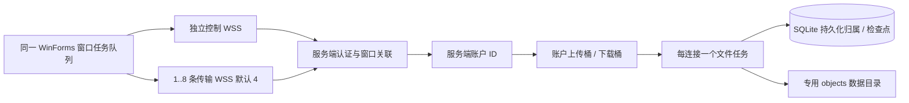
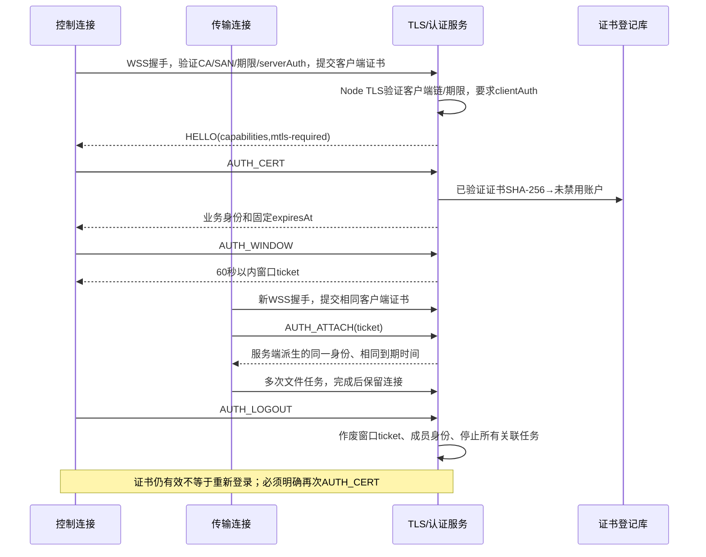
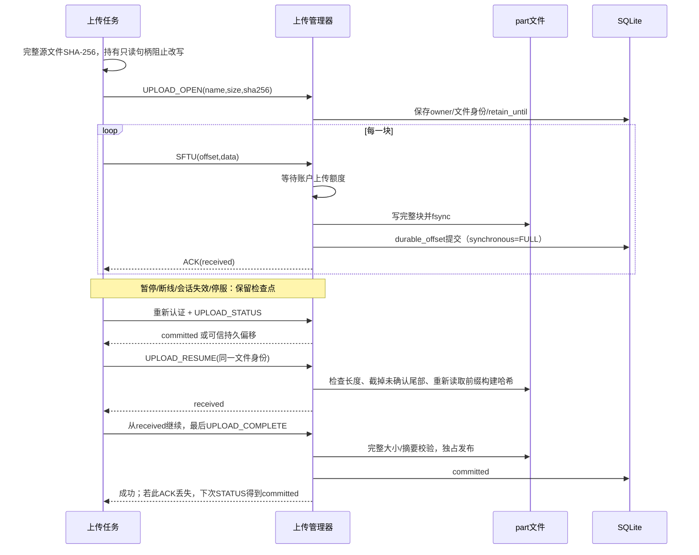
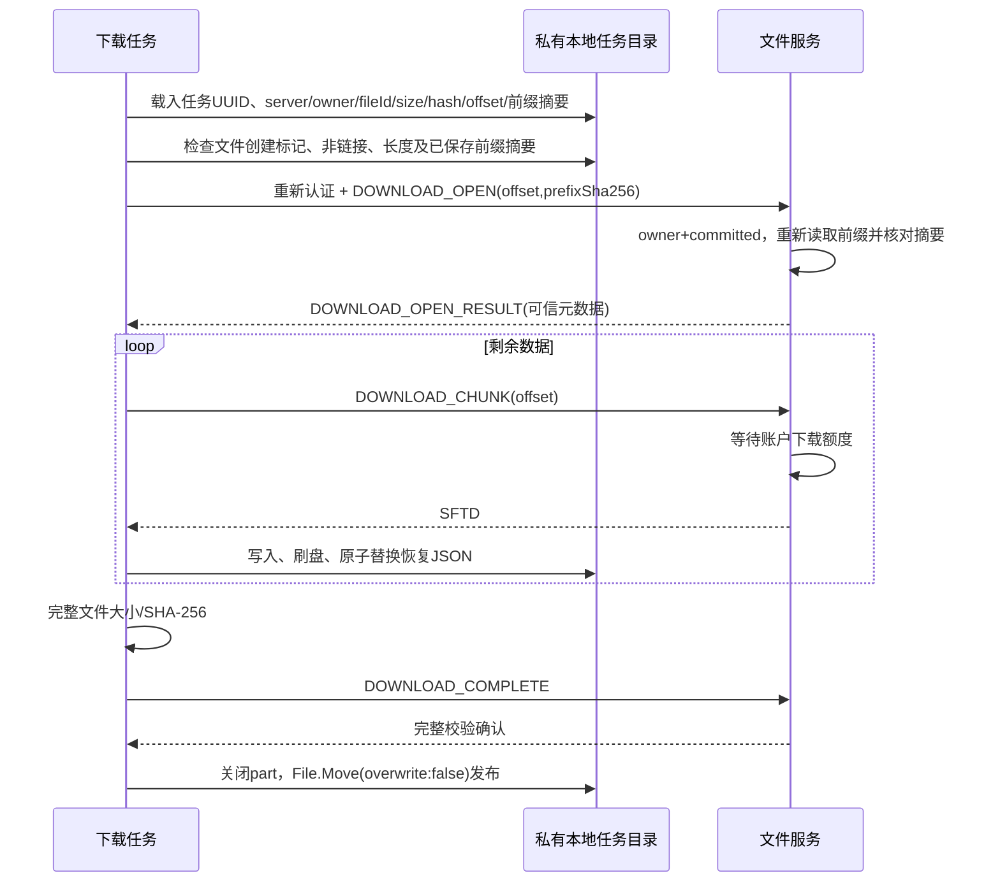

# 增强版协议、身份、并行及续传（软件 4.0.0）

本文是增强版的当前约定。JSON 包络 `version:1` 和二进制头 `version=1` 保持兼容；新增消息通过 HELLO 的 `data.capabilities` 明确公告 `window-auth-v1`、`resume-v1`、`account-bandwidth-v1`。新客户端在使用前要求前两项能力，不满足即拒绝，不能把旧 BEGIN 当作可恢复任务。未知 version/type 被服务端拒绝。旧 BEGIN/COMPLETE/CANCEL 仍可使用，但旧上传不保留断点；新 GUI 使用 OPEN/RESUME。

## 分层与报头

TLS 负责密码学保护；WebSocket 提供完整消息边界、分片重组和 PING/PONG；应用头负责请求关联、任务关联、偏移和数据长度。没有重写 TCP/TLS，也没有为外观添加 TCP 序号等字段。SHA-256 是内容一致性检查，授权依据始终是服务端认证身份。

| 字节偏移 | 字节数 | 内容及处理 |
| --- | --- | --- |
| 0 | 4 | ASCII SFTU 上传 / SFTD 下载 |
| 4 | 1 | 版本 1，其他值拒绝 |
| 5 | 1 | 上传 1 / 下载 2 |
| 6 | 2 | 必须为 0 |
| 8 | 36 | requestId，小写 UUIDv4 ASCII；不用 C# Guid.ToByteArray |
| 44 | 36 | uploadId / downloadId，小写 UUIDv4 ASCII |
| 80 | 8 | 大端无符号偏移，单位字节；JS 还检查安全整数及文件范围 |
| 88 | 4 | 大端无符号负载长度，1..8192，必须等于 WebSocket 消息余长 |
| 92 | 1..8192 | 原始文件字节，无 Base64 |

单块最多 8284 字节；WebSocket 单消息总限制 16384 字节。C# 持续收包，累积分片后解析头；上传用 JSON ACK 确认，下载用请求 requestId 对应二进制响应。零字节文件不发送空块。两种报头已在真实 C#/Node 联调中逐字节核对。

## 包络与所有控制消息

UTF-8 JSON：`{version:1,type,requestId,data:{...}}`。requestId 为 UUID，服务端回复还含 connectionId，所有后续消息必须匹配 HELLO。错误是 `ERROR`，含 code 与可选 message/requestId。数值大小、偏移、速率均为**字节或字节/秒**；时间字符串为 UTC ISO-8601。全部消息受 16 KiB 限制。

| 请求/通知 | 字段、长度及处理 | 结果 |
| --- | --- | --- |
| HELLO 通知 | connectionId；data.capabilities 字符串数组；authMode=password 或 mtls-required | 客户端核对能力与模式 |
| ECHO | text ≤1024 UTF-16 单元 | ECHO_RESULT 原文；不延长身份有效期 |
| AUTH_LOGIN | username 3..32 ASCII；password 至少12 Unicode码点、最多256 UTF-8字节 | 服务端 scrypt 校验，AUTH_LOGIN_RESULT 身份；mTLS必需模式拒绝 |
| AUTH_CERT | `{}`，可选 username 只能作为一致性校验 | 服务端使用已验证 TLS 证书 SHA-256 登记映射，AUTH_CERT_RESULT；CN 不作为账号 |
| AUTH_ME | `{}` | userId、username、expiresAt；不能创建身份 |
| AUTH_LOGOUT | `{}` | AUTH_LOGOUT_RESULT；业务身份清除，控制 WSS 可保留；控制连接的关联成员统一失效 |
| AUTH_EXPIRED 通知 | `{}` | 取消任务执行，保持可恢复数据；必须重新认证 |
| AUTH_WINDOW | 已认证控制连接 `{}` | 随机256位 ticket，43字符 base64url；expiresAt≤60秒且≤控制身份到期；maxConnections=8 |
| AUTH_ATTACH | ticket，43字符；任何客户端填写 userId/username 均不参与授权 | 另一 WSS 真实验证 ticket 和控制会话；mTLS 下还要求相同已验证证书；返回同一身份与原绝对期限 |
| FILES_LIST | limit=1..20，默认10；cursor≤256字符或null | 本人 committed 文件数组及 nextCursor；键集分页，游标签名绑定用户 |
| UPLOAD_BEGIN（兼容） | name 1..120 UTF-16且≤240 UTF-8字节；无非法路径/设备名；size=0..104857600 | uploadId、chunkBytes=8192；中断立即清理 |
| UPLOAD_OPEN | 同上 + sha256=64小写十六进制，上传前对完整源文件计算 | UPLOAD_OPEN_RESULT：uploadId、received=0、chunkBytes；持久记录归属、大小、摘要及保留期 |
| UPLOAD_RESUME | uploadId、name、size、sha256 必须与既有记录一致 | UPLOAD_RESUME_RESULT：服务端可信 received、chunkBytes；其他用户/过期任务拒绝，同时接管拒绝 |
| UPLOAD_STATUS | uploadId | uploadId、state、received（持久检查点）、name、size、sha256；已 committed 不重复提交 |
| SFTU 上传块 | uploadId、offset必须等于当前 received | UPLOAD_CHUNK_RESULT：uploadId、received；新上传刷盘并提交数据库检查点后才 ACK |
| UPLOAD_COMPLETE | uploadId、sha256=64字符 | 大小、完整哈希及声明哈希一致后持久提交，返回 fileId/name/size/sha256 |
| UPLOAD_PAUSE | 当前 resumable uploadId，须等当前块结束 | 停止执行、关闭句柄、保留检查点、释放活动槽位 |
| UPLOAD_CANCEL | 可省略 uploadId（只限当前连接） | 清理本次未完成数据；已提交返回 UPLOAD_ALREADY_COMMITTED |
| UPLOAD_FORGET | uploadId，仅本人、非活动、未完成 resumable 记录 | 清理暂停数据和配额；不是凭 ID 删除他人文件 |
| UPLOAD_ABORTED 通知 | uploadId、code | 当前任务停止，续传任务按保留规则处理 |
| DOWNLOAD_BEGIN（兼容） | fileId，仅本人 committed 文件 | downloadId、fileId/name/size/sha256/committedAt、chunkBytes |
| DOWNLOAD_OPEN | fileId、size、sha256、offset=0..size、prefixSha256=64字符 | 校验元数据及服务器已有文件的前 offset 字节摘要；返回 DOWNLOAD_OPEN_RESULT，另含 offset |
| DOWNLOAD_CHUNK | 当前 downloadId、准确 offset，UUIDv4 requestId | SFTD 响应，发送受账户下载桶约束 |
| DOWNLOAD_COMPLETE | downloadId | 服务器完整哈希（含恢复前缀）检查后返回 downloadId/fileId/size/sha256 |
| DOWNLOAD_CANCEL | 当前 downloadId可省略 | 关闭服务器读取任务；客户端“取消”删除自己的 part，“暂停”保留自己的 part |
| DOWNLOAD_ABORTED 通知 | downloadId、code | 终止当前下载，恢复需重新建立下载任务 |

列表每项仅 `fileId,name,size,sha256,committedAt`。不公开磁盘路径、口令记录或证书私钥。ID 都是定位符；每次列表、下载、状态查询、恢复、取消必须核对当前账户与归属。

## mTLS 与窗口认证

密码模式也使用此窗口关联，只有控制连接使用一次密码，传输连接用短时委托凭据完成认证。票据不落盘、不记录日志，不给身份延长有效期。仅控制连接可签发本窗口票据；每窗口最多8条传输连接。控制连接断线会撤销关联连接；独立窗口的另一控制会话不受影响。管理员禁用证书后，新认证立即拒绝，现有身份每次请求及每秒检查，上传/下载通过身份代次阻止旧回调继续提交。

## 上传恢复与提交

“收到”不自动等于“故障后可恢复”。只有文件 sync 成功且 SQLite 检查点提交的字节才被新协议 ACK 确认。进程崩溃后，记录外的尾部截掉；文件短于持久检查点则启动失败并要求检查，不能虚报恢复。提交中的临时硬链接在可证明归属时回退到 receiving；committed 永不因取消或 ACK 丢失删除。相同文件名不代表同一文件；本地和服务端均检查全长及完整 SHA-256。任务ID在独占活动集合中，不能被并发接管。

## 下载恢复与发布

本地恢复 JSON 只含任务元数据，不含密码、票据、PFX密码或私钥。part 路径由本地任务 UUID 在专用私有目录生成，不使用服务器路径。崩溃留下的未保存尾部只能在创建标记和已记录前缀都匹配后截掉。标记/摘要不一致时保留现场并拒绝使用或删除。目标存在时拒绝覆盖；删除仅涉及本任务 part，完成文件不会被取消清理。

2026-11-25 验收修订没有改变线协议或能力版本。本地检查点先写并刷盘 `.new`，再替换恢复 JSON。传输中的替换若遇到 Windows 短暂拒绝访问/共享冲突（错误5/32/33），最多尝试6次，异步延迟合计最多385毫秒；只重试已刷盘记录的替换，不绕过ACL，不无限等待。持续失败仍进入明确错误/待恢复状态，旧持久检查点保留；磁盘空间不足不属于该重试条件。首次入队记录保存失败撤销队列登记，允许故障解除后重试同一任务。上传ACK仍以服务端可靠检查点为准；最终目标发布仍禁止覆盖。

验证包含服务端部分写入、刷盘/SQLite检查点、提交失败及客户端下载写入/刷盘/JSON提交的**模拟磁盘空间不足测试**，另有真实Windows文件占用测试；均不能等同于真实磁盘满或真实断电。详细结果见 [本轮验收记录](acceptance-20261125.md)。

## 带宽、资源与长连接

上传/下载分别限额，单位字节/秒；不共享一个双向桶。默认 ordinary 上/下各1048576；管理员可设 VIP 或任意合法速率8192..104857600。tier和速率均取服务端 account_policy；tier文字不会让客户端获得权限。每账户每方向一个 FIFO 令牌桶，短时突发最多8192字节，所有窗口/连接共用。等待用异步定时器，每桶最多32个待处理块、最多128个桶，空闲60秒释放桶；不会阻塞健康检查、认证和PING/PONG。

默认全局16个活动文件任务、64条已升级WSS、96条TCP/TLS连接、100MiB单文件、1GiB存储总预留、1000条文件/恢复记录。一个传输连接仍只处理一个任务，完成后复用。GUI并发1..8，默认4，可同时2上传+2下载；任务记录最多100条，本地未完成下载预留最多1GiB。上传恢复保留24小时，仍占文件配额，定时及新上传时清理过期非活动记录。本地未完成任务保留7天，启动后台清理可证明归属的过期part；记录满100条时淘汰已完成/已取消历史，不删除完成文件。

每15秒 WebSocket PING，10秒PONG超时；C# KeepAliveInterval/KeepAliveTimeout 同样明确配置。接收循环是**应用内部后台任务**，未安装独立 Windows 守护服务。健康检查不替代心跳。文件消息等待120秒，非文件控制请求10秒；服务端传输空闲120秒、单次绝对24小时。账户业务会话仍绝对15分钟，未认证等待120秒，心跳、ECHO、ME和票据刷新均不能续期。

| 事件 | 执行状态 | 可恢复数据 | 再开始条件 |
| --- | --- | --- | --- |
| 文件正常完成 | 释放任务槽，复用连接 | 已发布完整文件 | 可继续其他任务 |
| 暂停 | 当前任务结束IO并释放槽 | 上传持久检查点 / 下载part与JSON保留 | 当前有效身份或重新认证后手动继续 |
| 意外断线 | 关联窗口任务停止 | 按保留期限保留 | 新连接重新认证、STATUS/RESUME |
| 主动取消 | 本任务停止 | 删除未完成服务端记录/part或本地part | 新任务；若提交已完成，不宣称撤销 |
| 注销/换证书/切换账户 | 整个窗口池停止，清除身份，换证书先断线 | 原账户任务保留，其他账户不能恢复 | 重新连接/认证原账户 |
| 正常关窗 | 等待任务停下并关闭关联连接 | 保留恢复记录 | 下次启动重新认证后手动恢复 |
| 会话到期/证书禁用 | 立即停止业务，旧回调不能提交 | 同上 | 有效新认证；禁用证书不能重入 |
| 服务重启 | 所有连接消失，恢复数据库检查点 | 已提交数据和可恢复上传保留 | 重新认证；真实进程退出/重启测试已执行 |

实现边界：本地记录丢失、UPLOAD_OPEN 返回前断线等情况可能留下无本地ID的服务器记录，受保留期/配额清理，不会从文件名推测接管。没有自动重连或静默恢复身份。损坏或归属不明的本地临时文件不自动删除。应用级证书禁用登记不是 CRL/OCSP。
