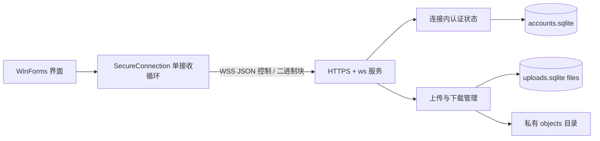
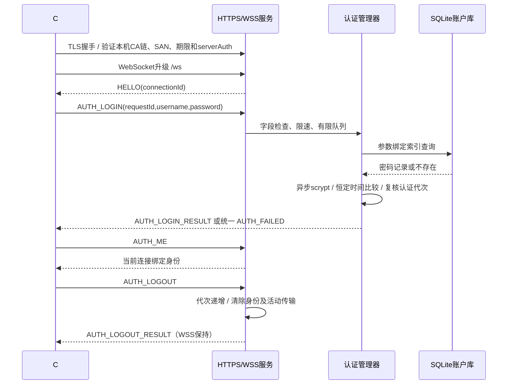
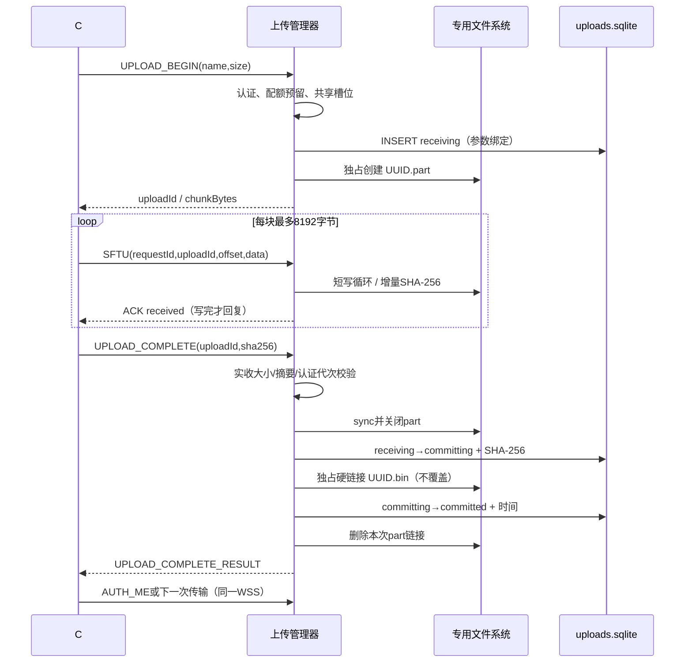
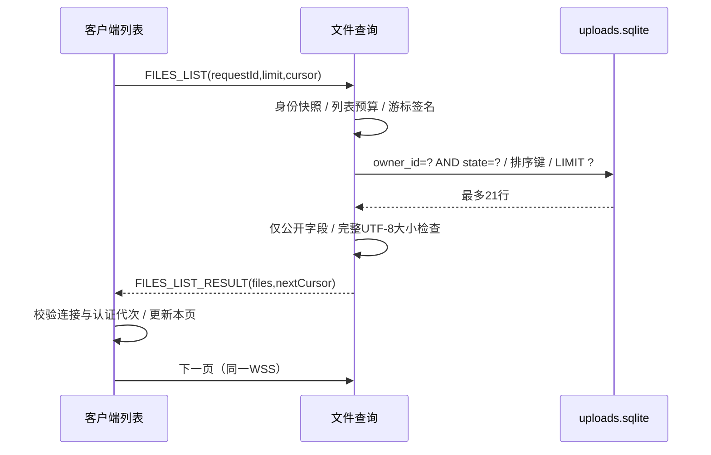
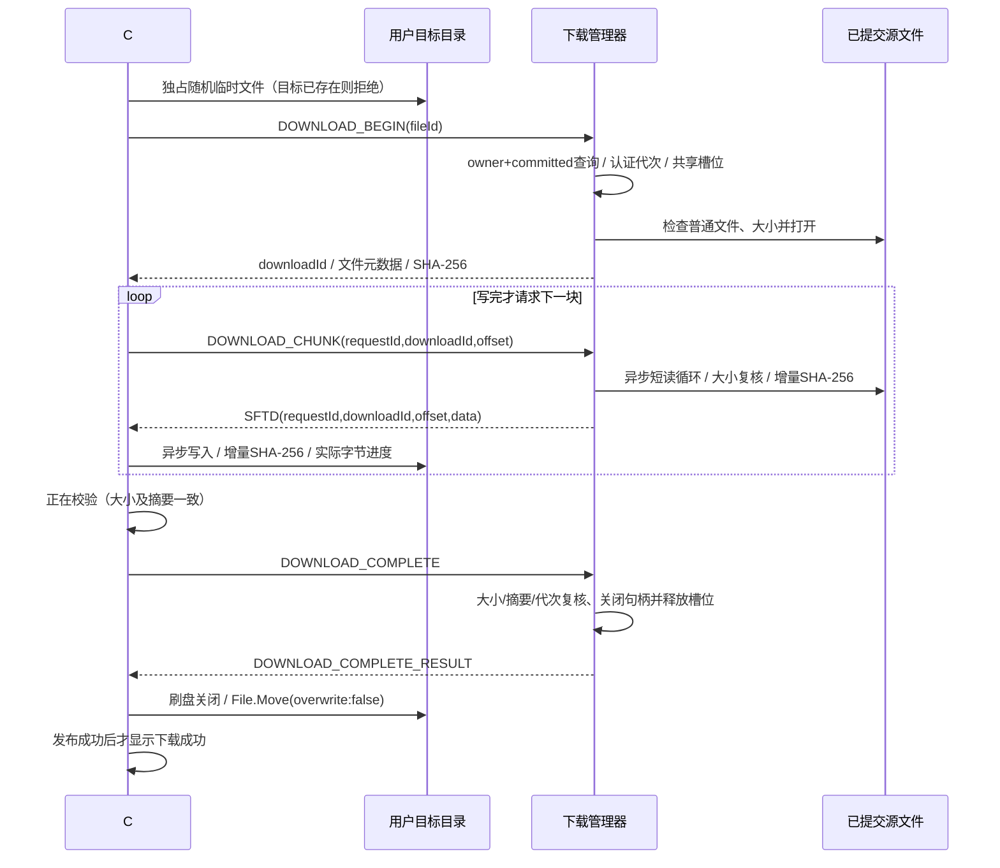
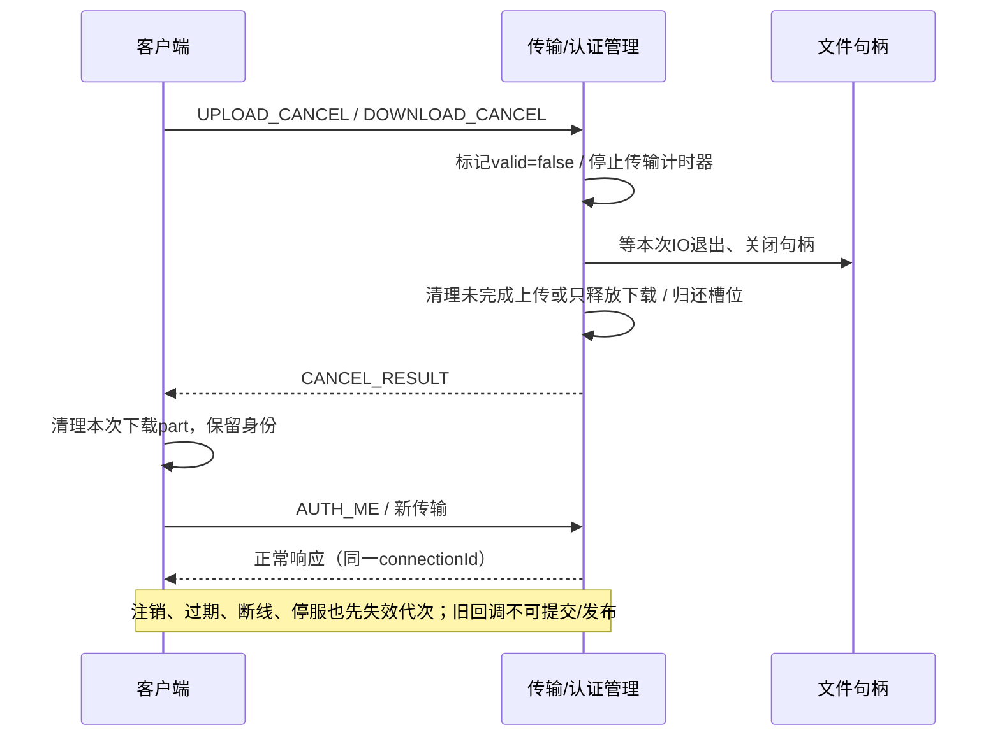
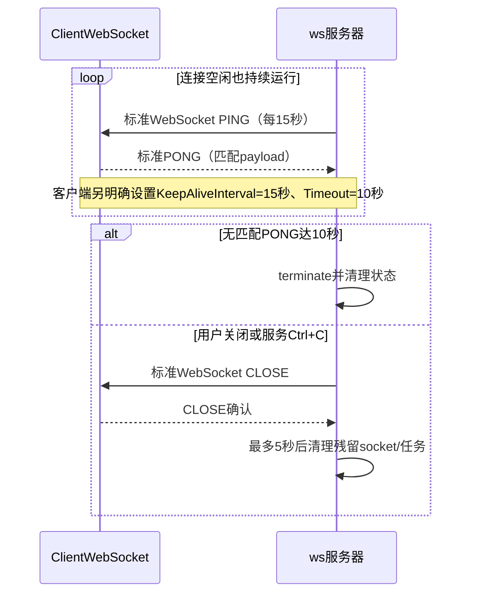

# 应用协议入口（增强版 4.0.0；线格式 version 1）

**当前协议以 [增强版完整协议](protocol-v4.md) 为准**，包括新增消息、能力协商、mTLS、窗口连接池、账户带宽和断点恢复。下面保留已验收 P5 的基础字段及历史设计，用于解释兼容消息；其中固定回环地址、单任务 GUI、任何中断删除、stage=P3 等陈述不再代表增强版。新健康响应为 stage=EnhancedV1、softwareVersion=4.0.0；新旧线格式都使用 version=1，通过 HELLO capabilities 区分新能力。

此文为 P4 核对后的当前协议定义；P0.1/P0.2/P1/P2/P3 文档保留各阶段历史证据。本轮后端包版本为 3.0.1，功能健康 stage 仍为 P3，线上消息 version 仍为 1，不把交付核对阶段当作协议升级。

## 分层、边界和设计原理



TLS 1.2+ 提供通信机密性、传输保护和客户端对服务器身份的验证。WebSocket 提供消息边界、分片、控制 PING/PONG 与 CLOSE。TCP 提供有序字节流；这些标准字段不属于下面的自定义应用头。本实现没有自行设计加密算法、TLS token、TCP 序号或 WebSocket 掩码字段。

应用层保留请求编号、文件偏移和摘要，是为了将并发控制请求与具体传输任务对应，发现大小/顺序/落盘错误，并使失败与最终提交状态明确。SHA-256 一致只证明相对于可信元数据的内容一致，不单独证明身份或机密性；信任来自本机 CA、TLS 验证和服务器连接认证。

默认 HTTPS 为 `https://127.0.0.1:8443/health`，WSS 为 `wss://127.0.0.1:8443/ws`。仅回环监听，无 HTTP 3000、无静态文件目录。`GET /health` 返回 status=ok、service=SecureFileTransfer.Server、stage=P3；未知 HTTP 路径返回 404。浏览器 Origin 的升级请求被拒绝，本阶段支持原生客户端。

## JSON 包络与标识

客户端文本消息必须是 UTF-8 JSON 对象：

```json
{"version":1,"type":"AUTH_ME","requestId":"00112233-4455-4677-8899-aabbccddeeff","data":{}}
```

| 字段 | 类型、限制和意义 |
| --- | --- |
| version | JSON 整数 1；不接受字符串 "1" |
| type | 下表列出的大小写敏感消息名 |
| requestId | UUID 字符串；JSON 路由接受 UUID 版本位1..8和标准 variant，大小写均可；实际 C# 请求使用小写 UUIDv4。**二进制相关 ID 严格要求小写 UUIDv4** |
| data | JSON 对象，不能为 null/数组；各消息字段见下表，额外 owner/userId 不参与授权 |
| connectionId | 服务器回复的当前连接 UUID；由 HELLO 建立，客户端检查后续 JSON 一致性 |

成功请求返回相同 requestId。HELLO、AUTH_EXPIRED、UPLOAD_ABORTED、DOWNLOAD_ABORTED 是无 requestId 的通知。合法消息通常复用原 WSS，不每次断开；重连创建新 connectionId，必须重新登录。每连接最多 8 个待处理客户端请求，10 秒超时，发送串行化。

统一错误包络为 `{version:1,type:'ERROR',connectionId,requestId?,code,message?}`。JSON 无法解析或 requestId 不合法时省略 requestId；通用格式错误可能不含 message，认证/文件错误提供固定公开提示。C# 显示本地错误码映射，不展示原始密码消息、内部路径或数据库异常。

## 消息字典

| 请求/通知 | data 与校验 | 成功结果 |
| --- | --- | --- |
| HELLO（服务器通知） | 无 data；含 connectionId | 客户端完成连接建立 |
| ECHO | text 字符串，≤1024 UTF-16代码单元 | ECHO_RESULT：text 原值；这是诊断，不是登录 |
| AUTH_LOGIN | username：ASCII字母开头、后续字母数字下划线，共3..32字符，转小写唯一；password：≥12 Unicode码点且≤256 UTF-8字节、有效Unicode，不 trim/截断 | AUTH_LOGIN_RESULT：userId、username、expiresAt（UTC ISO） |
| AUTH_ME | `{}`；仅当前连接身份 | AUTH_ME_RESULT：同上身份字段 |
| AUTH_LOGOUT | `{}` | AUTH_LOGOUT_RESULT：`{}`；连接保留 |
| AUTH_EXPIRED（通知） | `{}` | 清除身份和未完成传输，原连接可重新认证 |
| UPLOAD_BEGIN | name：有效Unicode、1..120 UTF-16单元且≤240 UTF-8字节；禁止路径分隔符、控制字符、Windows非法/设备名和尾部点/空格。size：0..104857600字节的安全整数 | UPLOAD_BEGIN_RESULT：uploadId、chunkBytes=8192 |
| SFTU二进制上传块 | 92字节头及1..8192字节内容，offset必须为累计已接收值，不能超出声明size | JSON UPLOAD_CHUNK_RESULT：uploadId、received（完成写入后的累计字节数） |
| UPLOAD_COMPLETE | uploadId，sha256（64个小写十六进制字符） | UPLOAD_COMPLETE_RESULT：fileId、name、size、sha256；数据库committed后才确认 |
| UPLOAD_CANCEL | uploadId可省略；省略只取消当前连接的上传；带ID须匹配 | UPLOAD_CANCEL_RESULT：uploadId或null；已提交则UPLOAD_ALREADY_COMMITTED |
| UPLOAD_ABORTED（通知） | uploadId、code | 未完成上传失效 |
| FILES_LIST | limit默认10、整数1..20；cursor省略/null表示第一页，非空字符串≤256字符 | FILES_LIST_RESULT：files数组、nextCursor（末页null） |
| DOWNLOAD_BEGIN | fileId（小写UUIDv4） | DOWNLOAD_BEGIN_RESULT：downloadId、fileId、name、size、sha256、committedAt（UTC ISO）、chunkBytes=8192 |
| DOWNLOAD_CHUNK | downloadId、小写UUIDv4 requestId；offset为当前累计已发送字节的非负安全整数 | SFTD二进制，requestId对应本次请求；无另一个JSON块ACK |
| DOWNLOAD_COMPLETE | downloadId | DOWNLOAD_COMPLETE_RESULT：downloadId、fileId、size、sha256 |
| DOWNLOAD_CANCEL | downloadId可省略，语义同当前连接上传取消 | DOWNLOAD_CANCEL_RESULT：downloadId或null |
| DOWNLOAD_ABORTED（通知） | downloadId、code=DOWNLOAD_CANCELLED | 下载失效，清理本次本地临时文件 |

列表 files 每项只有 `fileId,name,size,sha256,committedAt`。权限使用服务器的 userId 和 committed 状态；按 committedAt 降序、fileId 降序。游标是时间/ID的base64url内容及绑定用户的HMAC-SHA256，启动时密钥随机生成，无无界游标表。使用键集分页，SQL最多21行；整个JSON UTF-8序列化后≤16384字节，必要时少返回行并更新游标。翻页不是冻结快照；新上传请刷新首屏，重启后旧游标须刷新。

不存在或无权下载都返回 FILE_NOT_FOUND，不泄露他人元数据。另一连接即使同账户，也只能新建下载，不能接管既有 downloadId。uploadId/downloadId 是任务标识，**不是授权凭据**。

## 二进制帧头（上传兼容 P2，下载兼容 P3）

```text
字节偏移    0       4   5   6       8                      44                     80       88      92
          +-------+---+---+-------+-----------------------+----------------------+--------+-------+------
          | magic |ver|kind| zero | requestId ASCII (36)  | transferId ASCII(36) |offset  |length | data
          |   4   | 1 | 1 |  2   |                       |                      |BE u64  |BE u32 | 1..8192
          +-------+---+---+-------+-----------------------+----------------------+--------+-------+------
```

| 偏移 | 长度（字节） | 编码 |
| --- | --- | --- |
| 0 | 4 | 上传 ASCII `SFTU`，下载 ASCII `SFTD` |
| 4 | 1 | version=1 |
| 5 | 1 | kind=1（上传）/2（下载） |
| 6 | 2 | 保留为零；非零拒绝 |
| 8 | 36 | requestId，小写含连字符 UUIDv4 ASCII |
| 44 | 36 | uploadId/downloadId，同上 |
| 80 | 8 | 偏移 unsigned 64-bit，大端，单位字节；还须满足安全整数和文件范围 |
| 88 | 4 | payload长度 unsigned 32-bit，大端，必须等于消息剩余长度 |
| 92 | 1..8192 | 原始文件字节，无 Base64 |

最大消息8284字节；总WebSocket消息限额仍16384字节，分片累计后校验。UUID不用 Guid.ToByteArray，避免C#/JS字节序分歧。使用Latin1读取再校验ASCII，拒绝高位伪装。零字节文件不发空二进制块，直接完成校验。上传块 requestId 对应JSON ACK；下载块 requestId 对应此前的JSON CHUNK请求。

## 认证与连接时序



密码每账户16字节随机盐；scrypt N=131072、r=8、p=1、64字节派生、maxmem=192MiB。不存在账户也做同参数计算。认证绝对有效15分钟；未认证等待120秒（ECHO/心跳/重复未登录注销不延长），过期可原连接再登录。失效代次使旧异步结果无权恢复身份。

## 上传与持久提交时序



SQL与文件系统不是一个原子事务。状态机记录中间步骤，启动仅处理有记录且归属可证明的未完成对象；committed不因ACK丢失而删除。客户端完成确认丢失时显示结果不确定，不自动重传。P4修复：独占创建失败时，不能仅凭预留记录删除一个实际上未由该上传创建的part。恢复不扫描任意目录，不执行或解压内容。

## 本人列表时序



## 下载和本地发布时序



服务器文件名仅为SaveFileDialog建议；目录由用户决定。禁止覆盖包括发布前目标被其他任务创建的竞争。失败仅删除本次临时文件，不能删除目标或服务器源文件。进程被强制结束或磁盘持续拒绝删除时，可能留part，需人工确认清理。

## 取消、失效和保活时序





上述保活不是应用ECHO，也不是自己定义的JSON PING。正常完成/取消后不断开TCP；安全例外包括未认证超时、未回应PONG、协议/资源违规、人工关闭及停服。

## 限额与错误码速查

| 范围 | 上限 |
| --- | --- |
| WSS / TCP连接 | 32 / 64 |
| 重组后消息 / 每连接发送队列 | 16KiB / 64KiB；压缩关闭 |
| 每连接/全局活动传输 | 1 / 4（上传+下载共享，清理中仍占用） |
| 文件大小/总存储/记录数 | 100MiB / 1GiB（已提交+在途预留）/1000 |
| 传输无进展/绝对期限 | 30秒 / 10分钟；普通心跳不续期 |
| 登录并发/排队 | 每连接1；全局2计算+4等待，排队最多3秒 |
| 登录令牌 | 每连接5、每12秒补1；全局20、每3秒补1；失败退避1/2/4/8秒 |
| 列表预算 | 每连接突发5、每200ms补1；立即拒绝不排队 |

通用：INVALID_JSON、INVALID_MESSAGE。认证：AUTH_REQUIRED、AUTH_FAILED、AUTH_ALREADY_LOGGED_IN、AUTH_BUSY、AUTH_RATE_LIMITED、AUTH_SERVER_BUSY、AUTH_CANCELLED、INTERNAL_ERROR。上传：UPLOAD_BUSY、UPLOAD_LIMIT、UPLOAD_QUOTA、UPLOAD_NOT_FOUND、UPLOAD_CANCELLED、UPLOAD_SIZE、UPLOAD_HASH、UPLOAD_OFFSET、UPLOAD_STORAGE_ERROR、UPLOAD_ALREADY_COMMITTED。文件/下载：TRANSFER_BUSY、TRANSFER_LIMIT、INVALID_CURSOR、FILE_RATE_LIMITED、FILE_NOT_FOUND、FILE_UNAVAILABLE、DOWNLOAD_NOT_FOUND、DOWNLOAD_OFFSET、DOWNLOAD_CANCELLED。

WebSocket关闭码：1000正常客户端关闭，1001服务停止，1003畸形上传二进制，1008认证等待/不等ACK等策略违反，1009消息超限，1013发送积压。底层 ws 的UTF-8/帧协议校验还可能产生标准1007/1002等关闭；不伪造为应用错误包。

正确运行依据是请求ID关联、单接收循环、有序逐块流、严格偏移/大小、双端摘要、服务端身份代次、不可覆盖发布和有限生命周期的组合。测试证据见 [P4 核对表](p4.md)，不是仅凭时序图就证明所有环境安全。
