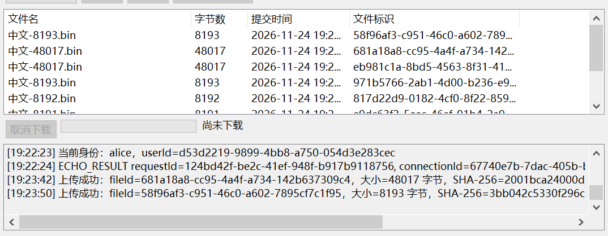
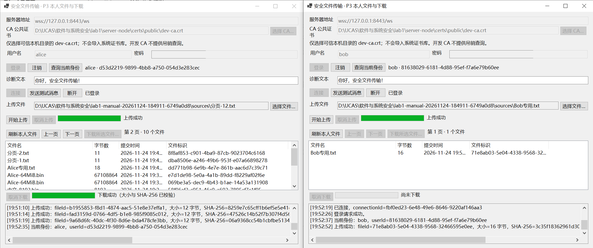
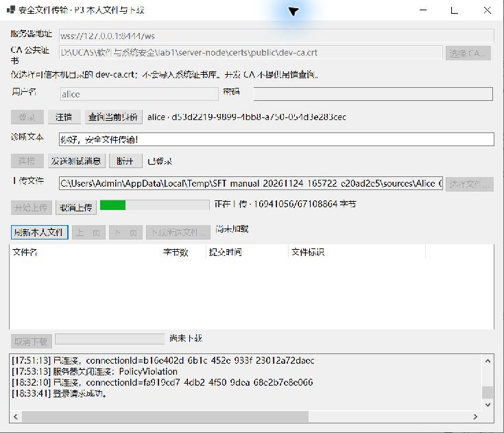
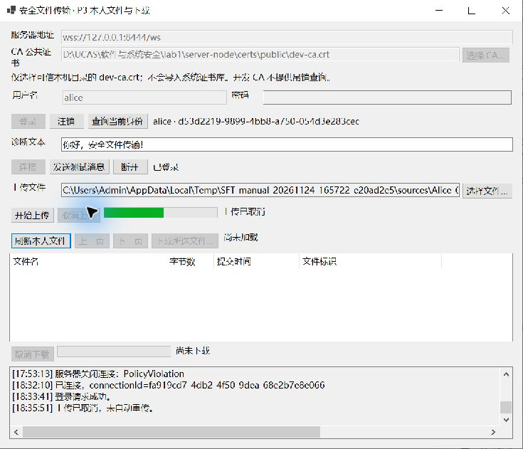

# 《软件与系统安全》实验1B：安全文件传输软件设计与实现

> **历史草稿，不代表增强版结论。** 以下正文保留已验收P5版本的报告素材；当前4.0.0架构、四项增强请使用 [增强版指南](enhancements.md)，验收修订的自动测试、真实GUI自动操作及限制请使用 [2026-11-25记录](acceptance-20261125.md)。用户人工确认与桌面自动操作分别记录，禁止移用本文旧GUI通过结果。

姓名：{{NAME}}  
学号：{{STUDENT_ID}}  
Git仓库链接：{{REPOSITORY_URL}}  
文档状态：2026-11-24 人工验收后更新的报告草稿。P5 独立源码复现已完成；P2/P3 GUI、P4 界面修复及 P5 真实 Ctrl+C 已获用户确认，27 项通过、D05 条件性未覆盖。业务功能冻结。姓名、学号、真实仓库链接、正式 PDF/DOCX 和 MP4 尚待补齐；未提交课程作业。

## 摘要

本实验实现基于C# WinForms、Node.js/Express/ws和SQLite的本机安全文件传输软件。客户端通过经过严格服务器证书验证的WSS长连接认证，在服务端绑定身份后上传、分页查看和下载本人文件。文件以8KiB有效数据块传输，通过大小及流式SHA-256校验确认内容完整；服务器逐块落盘后确认上传进度，客户端下载以独占临时文件和不覆盖发布保护已有文件。认证代次、共享传输槽位、有限队列、配额和超时用于约束资源与异步竞态。

自动验证包含真实TLS/WSS、实际C#网络源码和实际磁盘文件。P4在Node22.16.0的34组后端、四项目构建与9组三方核对记录保留；P5又从独立ZIP使用便携Node22.23.5还原构建，后端34组及修复后的真实C#9组三方核对通过。这些是 P4/P5 历史自动证据。2026-11-24 用户另行完成人工验收，26 项必做及 A04 通过，D05 因无合适不可写目录未覆盖；两类证据分别记录。真实磁盘故障、满容量和长期压力仍未验证。

## 1. 需求、威胁模型与范围

按课程课件第33、36页，系统需要支持多用户并发、完整传输、安全通信和显式keep-alive；报告应解释各模块时序和协议头。当前默认仅监听回环地址127.0.0.1:8443。攻击者可以建立未认证连接、发送恶意字段/帧、知道他人的fileId、快速提交有限测试范围的请求；不能因为客户端声称owner就获得授权。

可信边界包括本机应用目录、用户明确选取的CA公共证书及服务器受限存储目录。开发CA没有吊销服务；不承诺在本机管理员/进程已被攻陷、CA根被替换或操作系统被控制时仍安全。本实验不实现公开注册、OAuth、双因素、分享、删除、断点续传或自动重传；不公开网页，不执行或解压上传内容。

通信保护由TLS实现，SHA-256用于内容一致性，服务器连接认证用于用户授权。这些能力互补，不能用摘要一致替代身份校验，也不能把有限资源控制写成任意规模DDoS防护。

## 2. 架构与实现模块

客户端窗体管理用户操作，Networking目录负责证书验证、单接收循环、请求关联、认证状态和文件流；原Form1及设计器保留。ConnectionChecks编译同一组Networking源码，保证跨语言联调不是Node自测替代。现有C# Server/Protocol项目保留，但实际服务端为Node。

服务端service.js在同一HTTPS服务器上承载Express健康检查和ws升级；auth.js实现认证与会话，uploads.js/downloads.js管理文件任务。accounts.js访问accounts.sqlite；upload-store.js复用uploads.sqlite和私有objects文件目录；file-list.js负责本人分页。配置只接受专用本机数据/证书目录，运行秘密和数据不进入源码包。

users表保存UUID、规范化唯一用户名、盐、密码哈希、scrypt参数及创建时间。files表保存file_id、owner_id、connection_id、auth_generation、display_name、size、sha256、state和创建/提交时间。网络输入进入SQL时使用参数绑定；查询owner及committed状态由服务器确定，不复制第二套存储。

## 3. 应用层协议与时序图

以下内容由候选打包脚本从唯一的 `docs/protocol.md` 自动展开。维护协议时修改该文件，避免报告另写一套矛盾字段。Mermaid为图源，导出PDF/DOCX前须渲染并检查，不能仅把代码块当最终图形。

<!-- INCLUDE:protocol.md -->

## 4. 安全设计和本轮修复

TLS启动检查CA/leaf链、有效期、私钥匹配、localhost及127.0.0.1 SAN、serverAuth和TLS最低1.2。C#使用CustomRootTrust，仅信任用户提供的本地CA，校验主机名、链、有效期及用途；未发现无条件接受证书或关闭验证分支。开发环境无CRL/OCSP明确设置NoCheck，这仅关闭吊销查询，不关闭其余校验。

认证采用异步scrypt，独立16字节随机盐，固定N=131072/r=8/p=1/派生64字节/maxmem192MiB；恒定时间比较，同参数假记录抵消不存在账户的廉价路径。每连接一次登录、全局2个计算+4个排队，限速先于计算。密码不放URL/命令行/源码/日志，登录完成清空界面密码框；不可变字符串无法保证物理内存立即擦除。

权限判断只取连接绑定userId。列表只取本人committed记录，下载不存在/无权统一错误；所有任务还绑定connectionId及认证代次。注销、过期、断开使旧异步任务失效。路径使用服务器生成UUID，原名只为经过校验的元数据。下载目标由用户决定，独占临时文件且发布禁止覆盖。

P4确认并修复：

1. 原账户目录用icacls移除继承但没有清除其他主体的显式Allow。本轮复用统一私有路径权限函数，仅操作应用专用目录和已知SQLite/WAL/SHM文件；临时环境注入Everyone读权限，修复前残留、修复后移除，账户仍可查询。最终还核对目录规则的继承/传播标志，模拟仅当前用户但不继承的目录并验证修复及新文件继承。未以另一个Windows账户登录测试，不宣称完成跨OS账户渗透验收。
2. 上传独占创建遭遇同名碰撞失败时，旧清理仅凭预留记录删除part。修复为成功创建后记录created标志，失败清理仅删除本次确实创建的文件；隔离回归保留碰撞文件原内容并释放配额，之后正常上传成功。
3. 上传GUI回调原先只过滤连接代次，本轮增加认证代次，防止同连接切换账户后显示旧进度/结果。代码审查及构建为 P4 历史证据；2026-11-24 用户确认 F02 上传/下载中切换身份均通过，补齐相应人工验收。

另补固定消息量的发送积压模拟与零字节记录数配额测试。注入bufferedAmount和IOException属于模拟故障，未真的洪泛或填满磁盘。限额及状态机不是所有底层运行时漏洞的补丁。

## 5. 实验环境、运行及证据

P4历史版本见 `docs/p4.md` 和 `docs/evidence/p4-validation.json`：Node v22.16.0、npm11.12.1。P5当前已验证的便携运行时为Node22.23.5、配套npm10.9.9、SQLite3.54.1及内置OpenSSL3.5.9；Express5.3.0、ws8.23.0锁文件未变，.NET SDK11.0.100，WinForms目标net10.0-windows。证书生成另用已有OpenSSL CLI3.0.10。node:sqlite仍为实验性同步API，仅短小受控查询；昂贵密码计算与文件IO异步。系统Node没有被升级，必须明确指定便携路径；应用测试不证明操作系统及全部依赖无漏洞。

```powershell
Set-Location 'D:\UCAS\软件与系统安全\lab1'
$Node = 'D:\UCAS\软件与系统安全\lab1-tools\node-v22.23.5-win-x64\node.exe'
& $Node .\tools\run-node.mjs build
# 新副本才需要 run-node.mjs npm-ci / certs / user-create alice
& $Node .\tools\run-node.mjs start
# 另一个终端在源码根目录定义相同$Node：& $Node .\tools\run-node.mjs health
# 根目录另开终端：
# dotnet run --project .\SecureFileTransfer.Client\SecureFileTransfer.Client\SecureFileTransfer.Client.csproj --no-build
```

当前自动验证命令：`& $Node tools/run-node.mjs security`、`build`、`backend`、`csharp`。记录真实命令、开始/结束时间、退出码和stdout/stderr哈希，测试只使用独立临时目录与随机端口；P4修复前失败日志保留，不被后续成功覆盖。P5通过tools/reproduce.py将ZIP解压到项目外新目录，执行npm ci和含还原的完整构建，生成独立CA并严格校验；没有复制原依赖、bin/obj、账户、证书或上传数据。

| 证据类别 | 结论 |
| --- | --- |
| 历史证据 | P1七项GUI由用户确认，详见p1.md；P3历史29组+端口单项、9组三方校验只作为历史记录 |
| P4后端 | 34组、0失败，含TLS/授权/SQL输入/消息/并发/取消/超时/恢复和P4回归 |
| P4 C#构建 | 原四项目构建0警告、0错误 |
| 最终ACL补充回归 | 完整回归之后只改启动权限继承检查，相关4组安全测试再次通过；未改传输协议或客户端源码 |
| P4真实C#联调 | 严格证书正负例、认证、上传/下载、分片、9组三方哈希、取消/失效/防覆盖；61秒真实保活通过 |
| P5独立复现 | RC2后端34/34；RC3完整还原构建0警告0错误、安全4/4、真实C#9组三方校验及61秒保活通过；版本/归档映射见p5.md |
| 模拟故障 | 服务端写入/数据库提交失败、客户端下载写入失败、发送积压；不是物理磁盘损坏 |
| 2026-11-24 GUI 人工验收 | 用户确认 26 项必做及 A04 通过，共27项；D05条件性未覆盖。日志/截图支持的项目与仅用户确认的项目逐项标明，不以自动验证代替 |
| 本次交付整理 | 读取已有证据；9对既有源/下载文件只读大小及SHA-256复核一致；未重跑构建或整套业务测试 |

边界文件含0、1、8191、8192、8193、48017字节，另有65536字节并发样本；同名文件不同ID、中文名和分页验证。自动验证使用短时限/小配额验证边界逻辑；完整1GiB存储配额、1000条记录的GUI规模及长期压力未验证。人工最终核对另包含64 MiB文件。早期GUI记录观察了默认120秒未认证关闭和15分钟身份到期，后者恢复当时未完成；不能写成全部默认期限验收完成。

P5复现还发现并修复了验证工具的路径/环境问题：C#负例夹具原先通过PATH启动Node；C#管道输入依赖Windows代码页，在中文临时路径下JSON解析失败；Python汇总用默认GBK读取UTF-8审计失败。现在使用明确Node路径及子进程断言、明确UTF-8编码。失败日志与修复后证据均保留，未关闭TLS或绕过必要测试。普通受管环境禁止PS脚本，启动器改为直接执行JavaScript，不调整执行策略。外部SDK、OpenSSL、Python和还原网络是明确前置，不能宣称源码包完全无环境依赖。

## 6. GUI 人工结果、问题排查和实际图像

完整逐项结论见 [2026-11-24 验收记录](evidence/gui-20261124.md)，原始反馈见 [用户日志](evidence/manual-20261124/user-feedback.md)。26 项必做全部通过，条件项 A04 通过，D05 条件性未覆盖，合计27项通过、1项条件性未覆盖。只有“ok”的反馈明确记为用户人工确认；本报告不补造操作时刻、构建次数或显示缩放。用户没有提供实际缩放数值，G01仅覆盖用户本次环境。

用户已确认上传/取消/重试、分页与身份隔离、下载/取消/防覆盖、两个用户并行、注销/重连、传输中切换身份和关窗、真实Ctrl+C及重启、空闲后原连接继续使用。D05没有现成不可写目录，未修改ACL制造环境。历史C#通过BeforeWrite注入IOException验证无最终文件及临时清理，属于自动模拟故障，不能当作D05人工通过或真实磁盘故障。

### 6.1 完整性核对和 D02 源文件混用

用户最终确认0、1、8191、8192、8193、48017字节六种边界文件及67108864字节（64 MiB）文件，源/服务器/下载三份大小与SHA-256一致，重复上传对象也一致。最初D02选到了另一准备目录的同名源文件，产生摘要不一致；排查发现48017字节对象实际来自11月19日准备目录，摘要为2001bca24000d868d6417dbd3c23116c25f3d7505c03f6f2f7a74340418225e4，不能用11月24日同名但内容不同的文件比较。8193字节另用唯一名称D02-8193-20261124-202228.bin重做，用户确认三份一致；原排查经过保留。

本次文档收尾又只读核对9对已存在的源/下载文件，全部一致，见 [原始路径与摘要结果](evidence/manual-20261124/file-pair-recheck.json)。这次未重读服务器对象，也未重传文件，因此不冒称本轮自动完成新的三方传输测试。所有文件标识、摘要及不同批次的区别见完整验收记录。

### 6.2 实际截图及其证明范围



图1：用户原图可见同名8193字节对象的不同ID及上传成功日志。对应B03；分别下载的时间和完整摘要见原始反馈。图像未补画。



图2：两个窗口分别为Alice和Bob，地址均为wss://127.0.0.1:8443/ws；Alice第2页10项，Bob显示本人标记。对应A02、C01–C03，支持截图当时的身份及列表隔离。12个分页对象全部齐全的全过程来自用户确认，不能仅由这一帧推断。



图3：早期修复后通过本机透明TCP延迟夹具8444转发至8443，保持端到端TLS；图中仍在上传16941056/67108864字节。夹具是测试辅助，不是正式部署要求。



图4：同一受控延迟测试中的真正取消提示。原来的三次取消点击晚于提交，实际完成，仍保留为未覆盖取消；本图和用户后续B05日志属于另一次实际取消成功的证据。静态截图不冒充操作视频。

### 6.3 GUI 期间发现的问题及修复证据

首次B04大文件上传曾出现界面“未响应”。问题与逐8KiB进度向UI排队、触发布局更新相关；此前已新增UiTransferProgress，将上传和下载进度合并为最新值，由UI定时器每100ms最多刷新一次，并保留认证/任务代次检查。没有改变网络协议、分块、哈希或服务端。首次异常、取消过晚和修复后阶段观察均存档。用户最终确认B04、B05、F02、G01通过。本次收尾不再修改业务代码。

既有2026-11-24T10:47:32.787Z构建日志退出0、0警告/0错误，来源为 [历史结果](evidence/manual-20261124/existing-build-result.json) 和 [输出](evidence/manual-20261124/existing-build-stdout.txt)。本次只是核对日志，没有再构建；P4/P5整套自动数字保持历史含义。

### 6.4 尚待交付的材料

- 姓名、学号和真实Git仓库链接仍为占位；不从Windows用户名推断作者身份。
- 当前是有真实截图及证据的Markdown报告草稿；协议由唯一来源展开，Mermaid图源须渲染，正式PDF/DOCX需导出并逐页审阅。
- 未在项目和长期备份目录找到实际演示MP4；需按录屏脚本录制编译、部署、测试，实际播放并检查隐私。已有截图不替代视频。
- 报告/视频review标志保持false；GUI标志依据用户27/1确认置true，不通过改标志绕过其他交付条件。

## 7. 版本、复现和剩余限制

已有真实本地历史为P0.1 `36a202e`、P0.2 `7d8d925`、P1 `2aa0e32`。2026-11-24 收尾再次尝试普通 git add，仍因 .git/index.lock Permission denied 失败；普通Git写入受限，P2/P3/P4/P5累计源码保留但没有伪造分阶段提交；实际HEAD仍2aa0e32，P5历史归档映射见p5.md，当前含GUI修复和人工证据的候选见delivery-closure.md。无远端、未推送、未公开、未代提交课程网站。源码快照不是Git历史，后续必须补真实远端记录和公开状态。

源码包排除私钥、证书、实际账户库、WAL/SHM、用户上传内容、下载part、依赖与构建产物。内部恢复快照另存项目外，候选包只有源码和真实报告草稿，明确列出缺失项，不创建空MP4/PDF。

本地CA无吊销、回环部署、缺少续传/自动重传、未做真实磁盘故障/断电/大规模攻击/长期压力是明确限制。源数据在上传期间用FileShare.Read限制写入，并核对长度/时间与EOF。下载失败不删除已提交源文件；强杀可能留随机part，不能扫描用户目录盲删。未来扩展应先重新评估同步SQLite、配额公平性、备份恢复和运行时补丁。

## 参考与来源

1. 本地《实验1讲解2026》课件，第2、3、33、36页；P4已提取文本并查看这些页面的渲染结果，文件哈希记录在p4.md。
2. 项目源码与P1/P2/P3历史文档；当前协议定义为docs/protocol.md。
3. [Node.js 22.16 SQLite](https://nodejs.org/download/release/v22.16.0/docs/api/sqlite.html)、[crypto.scrypt](https://nodejs.org/download/release/v22.16.0/docs/api/crypto.html#cryptoscryptpassword-salt-keylen-options-callback)。
4. [.NET ClientWebSocket.ReceiveAsync](https://learn.microsoft.com/en-us/dotnet/api/system.net.websockets.clientwebsocket.receiveasync?view=net-10.0)、[File.Move](https://learn.microsoft.com/en-us/dotnet/api/system.io.file.move?view=net-10.0)。
5. [Node 2026-11-11安全公告](https://nodejs.org/en/blog/vulnerability/november-2026-security-releases/)、[22.23.5安全发行记录](https://nodejs.org/en/blog/release/v22.23.5)，P5 查阅并验证便携版；系统运行时未自动升级。
